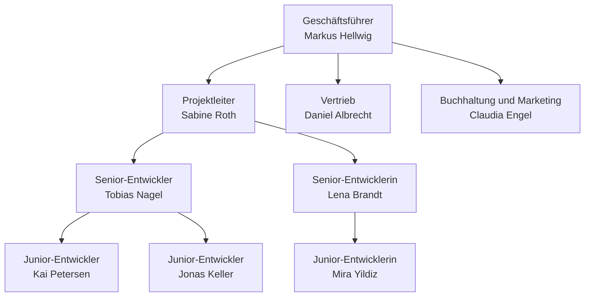

# Fiktive Firma: Nordlicht KI-Werkstatt

Entwurf aus Sprint 1, mit KI-Unterstützung (Claude Code) erstellt und von der Gruppe noch nicht abgestimmt. Stand 2026-10-13. Alle Unternehmen, Personen, Kunden und Zahlen sind frei erfunden.

Die Firma ist der Rahmen für den Change-Request-Agenten (siehe [kandidatenbogen.md](kandidatenbogen.md)): ein kleines Softwarehaus mit höchstens zehn Mitarbeitenden, spezialisiert auf KI-Systeme, das kleinen und mittleren Unternehmen mit kleinen Automatisierungen den Einstieg in KI ermöglicht.

**Status der Angaben:** Festlegungen der Gruppe sind die Eckdaten (klein, höchstens zehn Personen, KI-Einstieg für KMU, Bestands- und Neubaukunden), die Rollen und die Entscheidung, dass der Projektleiter Annehmer ist. Alles andere ist ein Vorschlag oder eine Annahme und als solche zu kennzeichnen. Eine Namensgleichheit mit realen Unternehmen oder Personen ist nicht geprüft.

## Eckdaten

- **Arbeitsname:** Nordlicht KI-Werkstatt GmbH (Platzhalter, jederzeit ersetzbar).
- **Gründung und Größe (Annahme):** gegründet vor rund sechs Jahren, neun Mitarbeitende, ein Standort.
- **Leistung:** Kleine, abgegrenzte KI-Automatisierungen für KMU als Einstieg in KI, zum Beispiel Mail-Sortierung mit Antwortentwurf, Rechnungs- und Belegerfassung, Chatbot auf Basis der eigenen Dokumente, Angebots- und Textentwürfe aus Vorlagen. Jede Lösung ist eine kleine Software (meist auf n8n oder vergleichbaren Werkzeugen mit eigener Logik), keine große Plattform.
- **Geschäftsmodell (Annahme):** Neubauprojekte im Festpreis oder nach Aufwand, nach der Abnahme ein Wartungsvertrag. Wiederkehrender Umsatz kommt aus den Wartungsverträgen, weitere Entwicklung aus Change Requests.
- **Eigene KI-Nutzung bisher (Annahme):** Die Entwicklung nutzt KI-Coding-Assistenten. Der Umgang mit Kundenwünschen ist bisher manuell: Projektleiter lesen, erinnern sich und entscheiden nach Gefühl. Das ist die Ausgangslage, die der Agent verbessern soll.

## Rollen und Besetzung

Die Firma arbeitet mit Rollen. Für die IHK-Frage nach Prozessen "in jeder Abteilung" sind sie unten zu vier Abteilungen gebündelt.

| Rolle | Anzahl | Bezug zum Agenten (Vorschlag) |
|---|---|---|
| Geschäftsführer | 1 | Gibt große Change Requests frei, entscheidet bei Auslegungsstreit und vertragsrelevanten Reklamationen |
| Projektleiter | 1 | Annehmer: Alle Kundenäußerungen und Agent-Entwürfe landen zuerst bei ihm. Entscheidet allein bei inklusiven Wünschen, bestätigt bei unklaren Fällen die Kategorie nach Vertrag |
| Vertrieb | 1 | Akquise und Kundenbetreuung. Kommt nur dazu, wenn Geld verhandelt wird (Zusatzbudget, Angebot), nicht für den normalen Durchlauf |
| Senior-Entwickler | 2 | Schätzen Aufwand für unklare Fälle, nehmen Fehlermeldungen an, setzen Change Requests um |
| Junior-Entwickler | 3 | Setzen um, nehmen einfache Fehler an. Kein Freigaberecht |
| Buchhaltung und Marketing | 1 (Vollzeit, zwei Rollen) | Rechnet Change Requests ab, pflegt Vertragsstände. Marketing hat mit dem Agenten nichts zu tun |

Neun Personen insgesamt. Der Projektleiter ist Annehmer, damit nicht alles am Vertrieb hängt. Der Projektleiter trägt die technische Einordnung mit und zieht bei Bedarf einen Senior hinzu.

## Abteilungen und Personen

Die Gliederung in Abteilungen und alle Namen sind ein Vorschlag.

Als Bild: [organigramm.png](schaubilder/organigramm.png).

| Abteilung | Personen | Aufgabe | Bezug zu Kundenwünschen |
|---|---|---|---|
| Geschäftsleitung | Markus Hellwig (Geschäftsführer, Gründer) | Strategie, Verträge, Freigabe großer Beträge | Entscheidet bei Auslegungsstreit und vertragsrelevanten Reklamationen, gibt große Beträge frei (Grenze offen, nicht im Vertrag) |
| Projekte und Entwicklung | Sabine Roth (Projektleiterin), Tobias Nagel und Lena Brandt (Senior), Kai Petersen, Jonas Keller und Mira Yildiz (Junior) | Bau und Pflege der Kundensoftware | Projektleiterin nimmt alles an, bereitet vor, ordnet technisch ein. Seniors schätzen Aufwand und bearbeiten Fehler |
| Vertrieb und Kundenbetreuung | Daniel Albrecht (Vertrieb) | Akquise, Angebote, Kundenbeziehung | Kommt nur bei Zusatzgeld dazu und entscheidet kommerziell (Grenze offen, nicht im Vertrag) |
| Verwaltung und Marketing | Claudia Engel (Buchhaltung und Marketing, Vollzeit) | Rechnungen, Vertragsstände, Außenauftritt | Rechnet Change Requests ab und pflegt den Vertragsstand |

Berichtswege: Projektleiterin, Vertrieb und Verwaltung berichten an den Geschäftsführer, die Seniors an die Projektleiterin, jeder Junior arbeitet einem Senior zu. Tobias Nagel hat zwei Juniors (Kai Petersen, Jonas Keller), Lena Brandt einen (Mira Yildiz).

## Zuständigkeiten und Schnittstelle zwischen Projektleiter und Vertrieb (Entwurf)

Der Projektleiter ist im Kern Annehmer. In der Wartung mit Sonderbudget ist der Vertrieb beteiligt, im Neubau mit Kontingent der Projektleiter, und beide müssen sich abstimmen. Es soll nicht alles auf den Vertrieb fallen. Die Schnittstelle ist als feste Regeltabelle gefasst (Vorschlag). Der Agent schlägt die zuständige Rolle aus Vertragsart und Ergebnis per Regel vor, ein Mensch bestätigt.

| Fall | Annahme | Entscheidet | Grund |
|---|---|---|---|
| Wunsch inklusive, jede Vertragsart | Projektleiter | Projektleiter | Planung, kein Geld im Spiel |
| Neubau, im Kontingent | Projektleiter | Projektleiter | Kontingent ist bereits vereinbart, nur Verbrauch buchen |
| Neubau, außerhalb des Kontingents | Projektleiter bereitet Entwurf vor | Vertrieb, Betragsgrenze offen (nicht im Vertrag) | Zusatzgeld muss verhandelt werden |
| Wartung, Wunsch außerhalb des Vertrags oder Sonderbudget nötig | Projektleiter bereitet Entwurf vor | Projektleiter oder Senior nach Ziffer 6.4, Vertrieb bei Zusatzgeld (Betragsgrenze offen) | Neues Geschäft mit dem Kunden |
| Wartung Plus, im Stundenkontingent | Projektleiter | Projektleiter | Kontingent nicht im Vertrag geregelt, offen |
| Fehler | Projektleiter leitet weiter | Senior-Entwickler (Fehlerliste) | Technische Einordnung |
| Reklamation | Projektleiter | Projektleiter, Vertrieb wird informiert, bei Vertragsrelevanz entscheidet der Geschäftsführer | Kundenbeziehung, mögliche Fristen |
| Unklar oder Auslegungsstreit | Projektleiter | Geschäftsführer bei Vertragsauslegung, Projektleiter mit einem Senior bei technischer Einordnung | Verantwortung bei der Leitung |

**Schnittstelle in einem Satz:** Der Projektleiter bereitet jeden Fall mit Fundstelle, Kategorie und Vertragsstand vor, der Vertrieb übernimmt nur die kommerzielle Entscheidung in den beiden Zeilen mit Zusatzgeld. So bekommt der Vertrieb weder die Annahme noch die inhaltliche Prüfung.

## Kundenbestand

Bewusst klein gehalten, weil die Testmenge handhabbar sein muss. Acht Kunden, davon fünf im Bestand mit Wartungsvertrag und drei im Neubau. Die Vertragsbezeichnungen sind Arbeitsnamen, bis die Vertragsrecherche echte Vertragsarten liefert.

| Kunde (fiktiv) | Branche | Größe | Software | Vertragsart (Arbeitsname) |
|---|---|---|---|---|
| Hansa Sanitärgroßhandel | Großhandel | 45 MA | Mail-Sortierung mit Antwortentwurf | Wartung Plus mit Stundenkontingent |
| Kanzlei Brandt und Partner | Steuerberatung | 18 MA | Belegerfassung | Wartung Basis |
| Hausverwaltung Rosenau | Immobilien | 12 MA | Chatbot auf Mieterdokumenten | Wartung Basis |
| Schreinerei Feldmann | Handwerk | 25 MA | Angebotsentwurf aus Vorlagen | Wartung Plus mit Stundenkontingent |
| Reisebüro Sonnenkamm | Dienstleistung | 9 MA | Anfragen-Triage | Wartung Basis |
| Metallbau Dreyer | Fertigung | 60 MA | Dokumentensuche (im Bau) | Projektvertrag Festpreis |
| Autohaus Lindner | Handel | 35 MA | Terminassistent (im Bau) | Projektvertrag Festpreis |
| Logistik Weidenmeyer | Spedition | 80 MA | Frachtpapier-Erfassung (im Bau) | Projektvertrag nach Aufwand mit Budgetrahmen |

## Vertragsarten (Arbeitsstand, Platzhalter für die Vertragsrecherche)

| Vertragsart (Arbeitsname) | Typische Abdeckung (Annahme) | Abrechnung von Änderungen |
|---|---|---|
| Wartung Basis | Fehlerbehebung am Gelieferten, Sicherheitsupdates, Anpassung an geänderte Schnittstellen. Neue Features nicht enthalten | keins, jede Änderung ist Zusatzleistung |
| Wartung Plus mit Stundenkontingent | wie Basis, dazu ein monatliches oder jährliches Stundenkontingent für kleine Änderungen | Stundenkontingent nicht im Softwarepflegevertrag, offen (Annahme: 8 Stunden pro Quartal) |
| Projektvertrag Festpreis | Leistung laut Leistungsbeschreibung, Änderungen außerhalb davon sind Change Requests | keins, aber ein vereinbartes Änderungsverfahren |
| Projektvertrag nach Aufwand mit Budgetrahmen | Arbeit im Rahmen des Budgets, Überschreitung braucht Freigabe | Budgetrahmen, nicht im Softwarepflegevertrag geregelt (offen) |

Ob diese Vertragsarten im Markt so üblich sind und wie die Klauseln lauten, ist ungeprüft und Aufgabe der Vertragsrecherche. Die rechtliche Einordnung ist nicht geprüft.

## Regeln der Firma, die der Agent anwendet (Annahmen)

- **Stundensatz:** 110 Euro netto für Entwicklung (Annahme). Plausibilitätsprüfung 2026-10-13: Anbieter-Ratgeber nennen für Agenturen im DACH-Raum 80 bis 180 Euro netto, der Freelancer-Median liegt bei rund 90 Euro ([tech-now](https://tech-now.io/blog/softwareentwicklungskosten-deutschland/), [freelancermap](https://www.freelancermap.de/blog/?p=72121)). Die Quellen sind überwiegend Anbieter-Marketing, also Richtwerte. Projektleitung wird nicht gesondert berechnet.
- **Kategorien für Änderungen (Vertrag, Source of Truth):** A bis 1.000 EUR ohne Auswirkung auf Architektur, Datenmodelle, Schnittstellen, Sicherheit oder Datenschutz, B Zusatzleistung, C größere Änderung (Ziffer 6.2). Die früheren Größenklassen (klein bis 4, mittel bis 16, groß bis 40 Stunden) sind ersetzt. Stunden folgen aus den Stundensätzen (Ziffer 7.4).
- **Freigabegrenzen:** Der Vertrag regelt keine Betragsgrenzen für Vertrieb oder Geschäftsführung, die frühere 1.500-Euro-Grenze ist offen. Inklusive Wünsche entscheidet der Projektleiter allein.
- **Kulanz:** Die Firma darf im Einzelfall kulant sein (zum Beispiel bei besonders kleinen Wünschen eines Stammkunden). Der Agent trifft diese Entscheidung nie, er markiert den Fall und gibt ihn an den Projektleiter, der ihn nach der Tabelle oben weiterreicht.
- **Weiterleitung von Fehlern und Reklamationen (Vorschlag):** Es gibt keine eigene Support-Rolle. Der Projektleiter nimmt sie an, Fehler gehen an die Senior-Entwickler (Fehlerliste), Reklamationen bleiben beim Projektleiter, bei vertraglicher Relevanz entscheidet der Geschäftsführer. Der Agent verwirft sie nie.

## Prozess heute in dieser Firma

Kundenäußerungen kommen über das Support-Postfach, über das Ticketsystem (Arbeitsstand: GitHub Issues oder Jira, offen) und in Statusgesprächen. Danach gilt der Ablauf aus dem Kandidatenbogen. Das Problem ist nicht fehlendes Können, sondern fehlende Systematik: Wer sich erinnert, entscheidet, und Kulanz wird nicht erfasst.

## Offene Punkte

- **Demand (Knut):** Wie viele Äußerungen pro Monat pro Kunde, in welchem Mix aus Überlegung, Wunsch, Auftrag, Fehler, Reklamation? Das bestimmt die Testmenge.
- **Namen:** Ob die Beispielfirma und die Kunden so heißen sollen, und eine kurze Prüfung auf Namensgleichheit mit realen Unternehmen.
- **Breite für die IHK:** Ob vier Abteilungen bei neun Personen für die IHK-Frage nach Einsatzfeldern "in jeder Abteilung" genügen, bleibt eine Frage an den Tutor.
- **Zuständigkeitstabelle:** Stimmt sie, vor allem die Grenze, ab der der Vertrieb übernimmt?
- **Ticketsystem und Postfach:** Welche Werkzeuge kommen in die Demo?
- **Vertragsbasis (Michi):** Die recherchierten Vertragsarten ersetzen die Arbeitsnamen.
